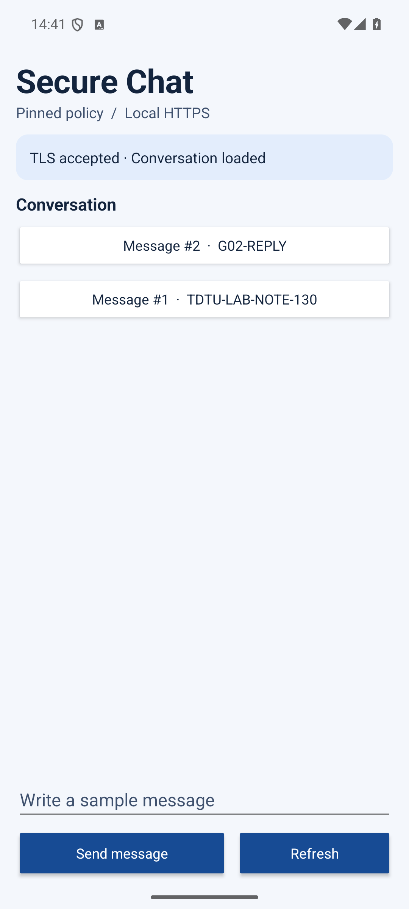
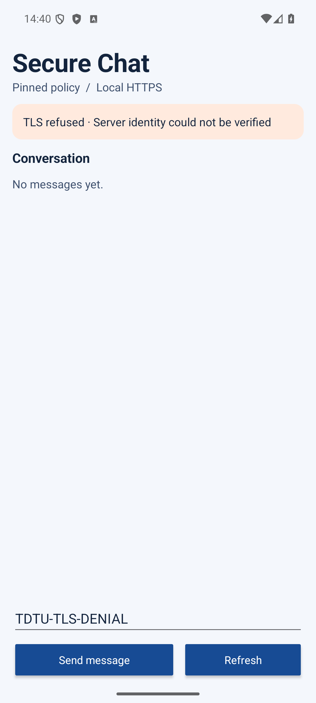
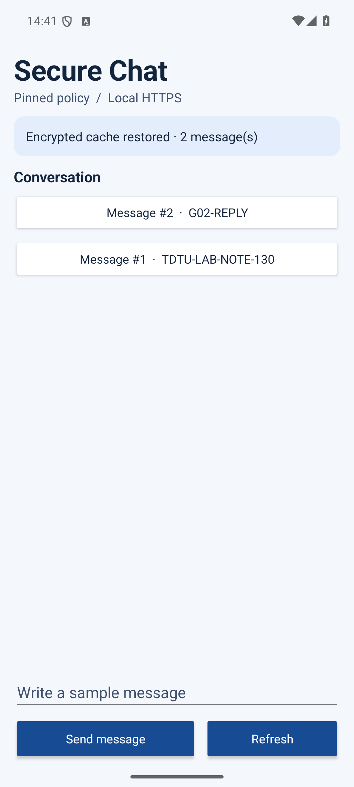

# Secure Android Chat

[](https://developer.android.com/about/versions/16)
[](evidence/results.json)
[](evidence/backend-unit-tests.txt)
[](LICENSE)

Two native Android clients share a local HTTPS chat. The demonstration shows how certificate pinning changes which server keys the client accepts, how Android limits access to message details, and how an encrypted cache lets the user read messages offline.

[Technical report (PDF)](report/Final_Demonstration.pdf) · [Editable report (Word)](report/Final_Demonstration.docx) · [Vietnamese demo script](DEMO_SCRIPT_VI.md) · [Verification log](evidence/android-run.txt)

<p align="center">
  
  
  
</p>

## What the demo shows

| Scenario | What to watch for |
| --- | --- |
| Certificate A | Both Baseline and Pinned connect successfully. |
| Certificate B | Baseline accepts the certificate. Pinned rejects its different public key before an HTTP request reaches the server. Both certificates use the same lab CA and hostname. |
| Recovery with A | One POST sends the draft and returns the updated conversation. Both apps can see the messages. |
| Message details | A tap opens details inside the app. Android denies a launch of the private Activity from the shell UID. |
| Offline cache | The app restores cached messages after restart. The Android test verifies AES-GCM rejects modified ciphertext. |

The [evidence folder](evidence/) also covers the backup pin, rejection of an untrusted CA, portrait at 360 dp with 125% text, and draft preservation on rotation.

## Run on an emulator

Use Android SDK Platform 36, Build Tools 36.0.0 or newer, an Android 16 API 36 emulator, ADB on PATH, JDK 25, Python 3.11 or newer, and OpenSSL 3 or newer. Set `JAVA_HOME` and `ANDROID_HOME` to your installations. The Gradle wrapper uses Gradle 9.8.1 and Android Gradle Plugin 9.4.1. The first build needs access to Maven and Gradle repositories.

From a fresh copy of the repository on a POSIX shell:

```sh
python3 tools/prepare_tls.py
(cd android && ./gradlew :app:assembleDebug)
adb devices
```

Generate TLS fixtures once per working copy. Keep the generated resources, certificates and APKs together. Replace the example serial below with the one listed by ADB:

```sh
SERIAL=emulator-5562
adb -s "$SERIAL" install -r android/app/build/outputs/apk/baseline/debug/app-baseline-debug.apk
adb -s "$SERIAL" install -r android/app/build/outputs/apk/pinned/debug/app-pinned-debug.apk
adb -s "$SERIAL" reverse tcp:8443 tcp:8443
python3 -m backend.server a
```

Open **Secure Chat Baseline** and **Secure Chat Pinned** and tap **Refresh** in each. Stop the backend with Ctrl+C and run `python3 -m backend.server b` to compare the TLS decisions. Start fixture `a` again to send and receive messages. After the demonstration, stop the backend and run `adb -s "$SERIAL" reverse --remove tcp:8443`.

The Python backend binds to the host's loopback address and retains up to 30 synthetic messages in memory until restart. TLS private keys are generated locally and excluded from Git and the submission ZIP.

## Reproduce the results

```sh
python3 -m unittest discover -s backend
(cd android && ./gradlew :app:assembleDebug :app:assemblePinnedDebugAndroidTest :app:lintPinnedDebug)
python3 tools/verify_demo.py emulator-5562 evidence-local
```

Run this with port 8443 free, the TLS fixtures already generated, and a new output directory. The verifier installs the APKs, clears their previous data on the selected emulator, captures evidence, and removes its ADB reverse mapping on exit.

## Course and contributors

Introduction to Information Security · Final Demonstration · Topic 13

Tôn Đức Thắng University · Class N05 · Group G02 · Instructor Huỳnh Ngọc Tú, Ph.D.

| Member | Student ID |
| --- | --- |
| Ngô Lâm Tiến (leader) | 524H0195 |
| Nguyễn Công Thành | 524H0191 |
| Võ Huỳnh Duy Tân | 524H0187 |

## License

Original project code is under the [MIT License](LICENSE). The bundled Gradle Wrapper uses its [Apache 2.0 license](android/gradle/wrapper/LICENSE-APACHE-2.0). Course materials, reports, logos and evidence are outside the MIT grant.
